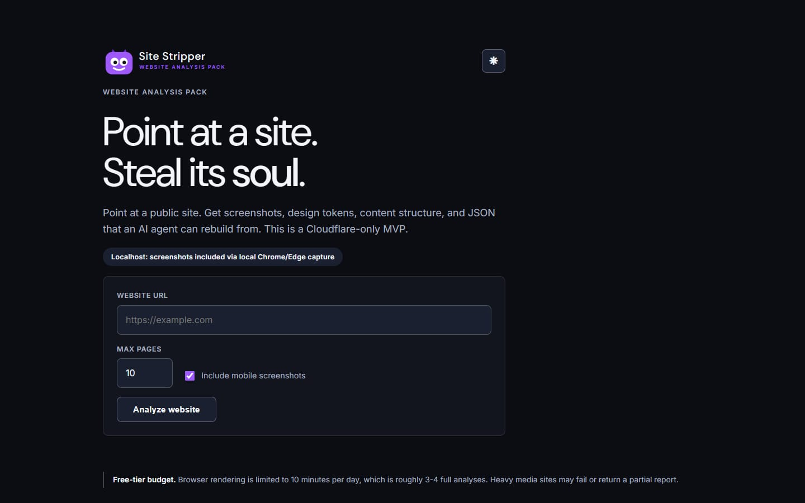
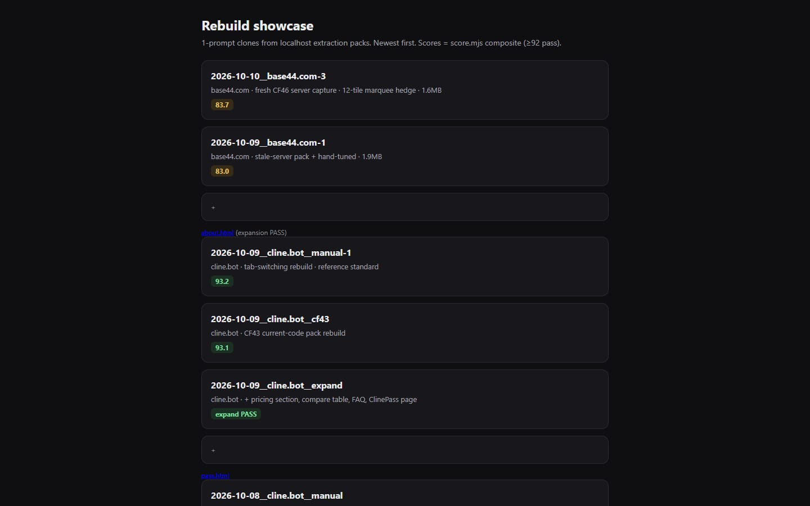
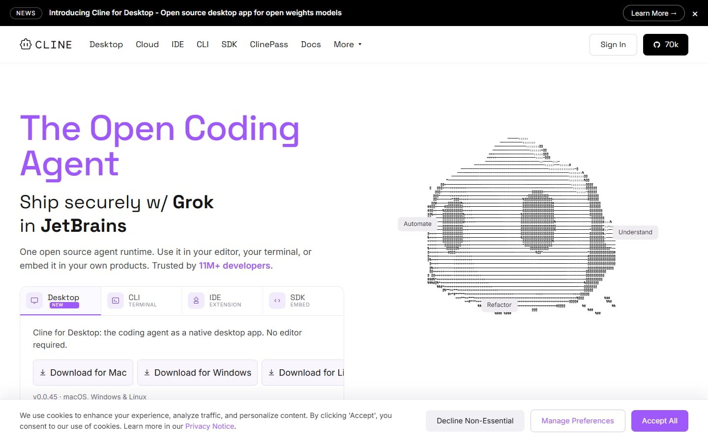
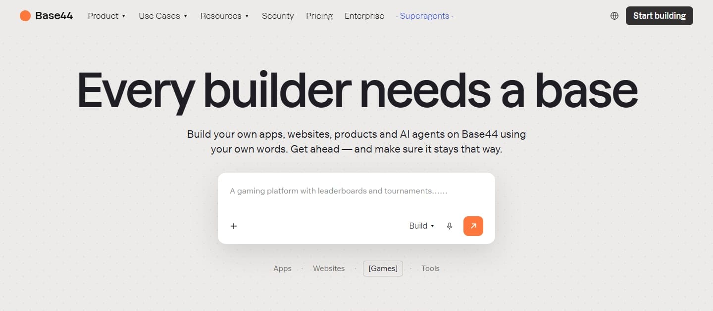

# Site Stripper — Website Analysis Pack

Site Stripper captures the visual DNA of a public website in a comprehensive reference ZIP. Give the pack to Claude, Codex, OpenCode, Cursor, and any other AI coding agent as a structured starting point for a new site in the reference's style. One recorded one-prompt evaluation on a clean content site scored 93.2/100; results vary with site complexity, source coverage, and agent.

Cloudflare Pages + Workers on the **Free tier only**. No VPS, Docker, external browser service, database, or AI API in production.

## Screenshots

| | |
|---|---|
|  |  |
| **The app** (`localhost:8917/app/`): paste a URL, get a ZIP pack. | **The proof** ([gallery](https://site-stripper-tests.pages.dev)): 15 one-prompt rebuilds with scores. |
|  |  |
| **cline.bot clone — 93.2** ([live](https://site-stripper-tests.pages.dev/2026-10-09__cline.bot__manual-1/)): tab-switching hero, cookie bar, hover states. | **base44.com clone — 83.7** ([live](https://site-stripper-tests.pages.dev/2026-10-10__base44.com-3/)): dotted paper, prompt box, marquee hedge. |
|  | |
| **Mobile 390 px**: fluid reflow, natural wraps, no desktop constraints. | |

## How it works

```text
Cloudflare Pages (dist/site): static marketing routes only
Existing Cloudflare Worker API ──▶ Browser Rendering (Chromium)
Local Node server: marketing routes + analyzer at /app/ + local /api/analyze
        │                         one session, sequential tabs
        ▼                         Bounded observations; local UI renders files
Local analyzer assembles the STORE ZIP in the browser
```

Heavy work runs inside Chromium (`page.evaluate`) or the client — never in Worker JavaScript (10 ms CPU budget). The Worker validates, sequences, and passes observations through.

## Quickstart (local)

Requires Node ≥ 20 and an installed Chrome/Edge.

```sh
npm install
npm run dev:local -w worker  # marketing pages http://localhost:8787/; analyzer http://localhost:8787/app/
```

Or on the standing local port with auto-restart:

```sh
./start-server.bat           # homepage http://localhost:8917/; analyzer http://localhost:8917/app/
```

The local server includes the marketing pages and analyzer at `/app/`. The analyzer is intentionally excluded from the hosted Pages bundle. Sign-up and sign-in screens validate fields in the browser and navigate to completion screens without creating accounts or saving submitted information.

## Commands

```sh
npm run typecheck -w worker  # tsc --noEmit, must be clean
npm test -w worker           # vitest (run focused test files individually; full suite may exceed memory)
npm run build:site            # create allowlisted marketing-only bundle at dist/site/
npm run dev:remote -w worker # local code vs remote Cloudflare resources (hosted verification)
npm run deploy -w worker     # deploy the Worker API (manual fallback)
npm run deploy:ui            # deploy the Pages UI (manual fallback)
```

## Deployments — every URL, what it's for, how it ships

Three Cloudflare targets, two local modes. Same wrangler, different commands:

| URL | What | Project / name | How it deploys |
|---|---|---|---|
| `https://forma-invoice.com` | **Site Stripper marketing site** (custom domain) | Pages `site-stripper-ui` | CI builds and uploads `dist/site` on push to `master` |
| `https://site-stripper-ui.pages.dev` | **Site Stripper fallback URL** | Pages `site-stripper-ui` | Same deployment as the custom domain |
| `https://site-stripper-api.momo00roro.workers.dev` | **Production API** (`POST /api/analyze`, `/health`) | Worker `site-stripper-api` | CI on push to `master` (gated) |
| `https://site-stripper-tests.pages.dev` | **Rebuild gallery** (15 one-prompt clones + scores, nothing else) | Pages `site-stripper-tests` | Manual direct upload (never CI) |
| `https://<hash>.site-stripper-ui.pages.dev` | **Preview snapshots** (one deploy frozen in time — not production) | Pages `site-stripper-ui` | Every CI deploy also leaves one |
| `http://localhost:8917` | **Local full capture** (unlimited, heaviest fidelity track) | `start-server.bat` → `tsx worker/local/server.ts` | Local process, restart after worker edits |
| `http://localhost:8787` | **Local Node server** (marketing site and analyzer at `/app/`) | `npm run dev:local -w worker` | Local development |

### Target 1 — Production UI (`site-stripper-ui.pages.dev`)

The marketing site lives at `/`, with static routes for `/features/`, `/how-it-works/`, `/sample-pack/`, `/faq/`, `/sign-up/`, `/sign-in/`, their completion pages, `/terms/`, and `/privacy/`. The Terms and Privacy pages are starter templates and still contain bracketed operator, contact, and jurisdiction fields. Replace those fields before treating the policies as finalized legal documents. The analyzer and client-side ZIP assembly remain local at `/app/` and are not included in the hosted upload.
Static files are copied from an explicit allowlist in `web/` to `dist/site/`. The analyzer's source and app-only assets remain in `web/` for local development and are excluded from that upload.

The sign-up and sign-in screens validate form values in the browser, clear them, and navigate to completion pages. They do not send the values to a server, create accounts, or retain account records. The analysis API returns results without persistent account history; Cloudflare may separately process technical and security logs according to its service configuration.

- CI: `npm run build:site`, then `npx wrangler pages deploy dist/site --project-name site-stripper-ui --branch ${{ github.ref_name }}`
  — `--branch master` is what promotes the upload to **production** instead of
  a preview. Without it, CI's detached HEAD produces preview-only deploys and
  production keeps serving stale HTML.
- Manual fallback: `npm run deploy:ui` (repo root; no `--branch` → preview URL only).

### Target 2 — Production API (`site-stripper-api…workers.dev`)

The brain. `worker/src/index.ts` via `worker/wrangler.jsonc`
(`name: site-stripper-api`, `nodejs_compat`, `BROWSER` binding for Browser
Rendering, `ENVIRONMENT`/`ALLOWED_ORIGINS` vars). Validates, sequences, and
passes bounded observations through — never Markdown/ZIP/image work in Worker
JS (10 ms CPU budget).

- CI: `npx wrangler deploy` with `working-directory: worker` (reads
  `wrangler.jsonc` there).
- Manual fallback: `npm run deploy:api` (→ `npm run deploy -w worker`).
- Health: `/health` reports `schemaVersion`; logs via
  `npx --prefix worker wrangler tail`.

### Target 3 — Rebuild gallery (`site-stripper-tests.pages.dev`)

The proof. Static exports of the best 1-prompt rebuilds (`showcase/`, 15
dirs + `index.html` scoreboard). A **separate Pages project on purpose**: the
main root stays the product, the gallery stays a gallery, and pushing product
code never redeploys (or wipes) the clones.

- Manual only (deliberately NOT in CI):
  `npx wrangler pages deploy showcase --project-name site-stripper-tests`
  from the repo root. Run it after adding new rebuilds to `showcase/`.
- No `--branch` flag → each upload becomes the production of *that* project.
- Per-deployment preview URLs (`https://<hash>.site-stripper-tests.pages.dev`)
  work the same as the UI project's.

### Preview URLs (both Pages projects)

Every `wrangler pages deploy` prints a `https://<hash>.<project>.pages.dev`
URL. Those are snapshots of one deploy, not production — always verify
against the canonical `site-stripper-ui.pages.dev` /
`site-stripper-tests.pages.dev` domains.

### Why GitHub Actions instead of Cloudflare's "Connect Git repository" button?

Both paths ship the same files. The difference is who runs the checks and how
many deployers exist:

- **GitHub Actions (what we use):** every push runs `typecheck` + the full
  test suite first; a red suite blocks the deploy. One deployer (repo-pinned
  Wrangler v4 on Node 22 via `npx`, in CI) pushes both the Worker and the Pages
  UI, including the `--branch master` flag so the upload promotes the
  production environment instead of a preview. Secrets live only as GitHub
  Actions secrets (`CLOUDFLARE_API_TOKEN` / `CLOUDFLARE_ACCOUNT_ID`); values are
  never committed. Pushes to `master` deploy automatically via
  `.github/workflows/deploy.yml` (also runnable by hand under the repo's
  **Actions** tab). The gallery project is never touched by CI.
- **Cloudflare Git integration (deliberately NOT connected):** Cloudflare would
  auto-build on every push with no typecheck/test gate, using its own Wrangler
  version and Pages build settings instead of ours. Running both at once means
  two deployers race for production. That is why Settings → Build → Git
  repository is intentionally left empty (Direct Upload via CI only).

ELI10: connecting the repo in Cloudflare's dashboard is like giving the printer
its own "print every draft" button — it skips the teacher checking your homework
(typecheck + tests) and two printers fight over the same paper. GitHub Actions
is the one printer that only prints after homework passes.

### ELI10: the whole deployment, in 5 lines

1. You `git push` your homework to GitHub.
2. A robot (Actions) checks it: spelling (typecheck), then the test suite.
3. Fail = stop, nothing ships. Pass = keep going.
4. Robot deploys the Worker API and the allowlisted marketing site to Cloudflare.
5. Your site updates at `site-stripper-ui.pages.dev`. The analyzer is available
   through local development at `/app/`; the showcase gallery updates only when
   a human runs its separate upload.

### One-time setup (already done — recorded here, never edit secrets in code)

1. `npx wrangler login`, then `npx wrangler whoami` to confirm the account.
2. First-time Pages projects (Worker needs no pre-creation):
   `npx wrangler pages project create site-stripper-ui --production-branch master`
   and `npx wrangler pages project create site-stripper-tests --production-branch master`
   (CI uses repo-pinned Wrangler v4 on Node 22 — not
   `cloudflare/wrangler-action`, which ships a stale v3).
3. GitHub repo → Settings → Secrets and variables → Actions — two secrets
   (names are case-sensitive; values are never committed):
   - `CLOUDFLARE_ACCOUNT_ID` — from Workers & Pages Overview in dash.cloudflare.com
   - `CLOUDFLARE_API_TOKEN` — custom token with **Account | Workers Scripts | Edit**
     and **Account | Cloudflare Pages | Edit** (minted once under My Profile → API Tokens)

### Useful terminal commands

```sh
git push origin master                    # deploy UI+API (triggers CI)
npx wrangler pages deploy showcase --project-name site-stripper-tests  # update the gallery (manual)
npx wrangler whoami                       # confirm Cloudflare identity
npx --prefix worker wrangler tail         # live Worker logs (repo root)
npx wrangler pages deployment list --project-name site-stripper-ui     # deploy history + preview hashes
```

Monitor browser-minute usage at dash.cloudflare.com → **Compute → Browser Run**
(free quota: 10 min/day, hard stop with 429s; quota resets daily at 00:00 UTC = 08:00 Singapore).

## Output package

```text
website-analysis/
  README.md  website-overview.md  information-architecture.md
  design-tokens.md  typography.md  content-style.md  design-system.md
  imagery-and-video.md  motion-and-interactions.md
  responsive-behavior.md  implementation-plan.md  REBUILD.md
  pages/*.md  screenshots/{desktop,mobile,sections}/
  data/{pages,tokens,layout,components,navigation,interactions,assets,selection,responsive-pairs,report}.json
  theme.css  theme.v2.css  tailwind.config.js  tailwind.theme.mjs  fonts.css  assets/
```

`data/pages.json` is canonical. Every Markdown file is a projection of the same bounded observations — never a second source. Each value carries source/confidence (`observed` / `inferred` / `unknown`), every capped collection reports source/emitted/cap/truncation, and gaps (bot challenges, video regions, pin scenes, pruned fields) are explicit limitations, not silent omissions.

## Key limits (Free-tier driven)

| Limit | Value |
|---|---|
| Pages per analysis | 10 max (homepage + 9) |
| Per-page extraction payload | 512 KB hard / 350 KB warn |
| Screenshots | 10 desktop, 2 mobile, 6 homepage sections; 10 MB total |
| Video shots | 12 max (`maxVideoShots`): autoplay-first, isolated motion-polled render, streamless-only click fallback; carousel pager (3 turns, stream-URL dedup); playing frames composited into sections client-side |
| Mobile | screenshots for homepage + 1 representative page; extract-only DOM comparisons for the rest |
| Wall budget | 150 s, hard — partial reports beyond it |
| Client documentation cap | 24 MiB (explicit error, never silent truncation) |
| Browser budget | ~600 s/day shared → roughly 3–4 heavy analyses (figma-class ≈ 3 min; light sites seconds) |

Never performed: form submits, control clicks, CAPTCHA solving, behavior replay. Bot-verification pages are recorded as evidence with remaining captures skipped.

## Docs

- `docs/01-PRD.md` — authoritative product/technical spec (read this first)
- `docs/plans/` — design and implementation plans, one merged record per feature (historical)
- `docs/images/` — screenshots used by this README (app, gallery, clones, mobile)
- `.examples/` — real captured packages from verification runs (latest per site; older runs under gitignored `.archive/`)
- `.testing/` — reference 1-prompt rebuilds (kept: 2 cline refs, cline expansion, 2 base44, softr.io; each with `score.json`; the rest in `.archive/testing/`)
- `scripts/eval/` — eval harness: `PROMPT.md` (1–3 prompt contract), `score.mjs` (composite gate ≥92), `expand-check.mjs` (UI-system adherence), `build-pack.mjs`, `capture-once.ts`, `regen-docs.mjs` (+ its own README; retired probes in `.archive/scripts-eval-probes/`)
- `showcase/` — published 1-prompt rebuilds, live at `https://site-stripper-tests.pages.dev` (separate Pages project; main UI untouched)

## Product and analyzer UI

The root page presents Site Stripper with an illustrated mascot, purple and
lavender surfaces, yellow accents, marketing pages, a sample-pack explorer,
and browser-only account screens. Those screens do not create accounts or
retain submitted information. The analyzer remains at `/app/` in the local
Node server and retains its light-first, Cline-influenced interface:

- Light-first theme: `#F8FAFB` canvas, `#151516` ink, `#9F58FA` accent,
  DM Sans display + Inter body, hairline borders, eyebrow section labels.
- Dark mode via header toggle (persisted, `prefers-color-scheme` default).
- Cline-exact components: segmented tabs with purple-underline actives,
  lavender CTAs (purple border, lavender fill, black text), 3-column
  clipped screenshot grid with Desktop/Mobile tabs, full-image overlay viewer.
- Environment pill derived from `API_BASE`: local capture notice vs a hosted
  capture notice that explains screenshots are included when captured. Raw
  JSON remains in a width-clamped accordion.
- Identity: the existing monster mark in `web/favicon.svg` and the analyzer
  lockup. The hosted `dist/site/` bundle excludes the analyzer UI and app-only
  assets; local developers open `/app/` directly.

## Status

CF01–CF31 are implemented. The analysis pipeline was verified against 15+ live archetypes (portfolios, Shopify/WooCommerce, docs sites, CJK, RTL, single-pagers, award sites, bot walls). The prior hosted analyzer release was verified 2026-09-26 (GMT+8); the current Pages source is a marketing-only site, and its analyzer remains local at `/app/`.

CF14–CF20 fidelity pack (2026-09-29): video posters, computed behaviors, `data/layout.json`, `REBUILD.md`, heading breaks, split rehydration budget, rotation re-sample. CF21–CF25 video capture (2026-09-30/10-01): facades render playing frames via autoplay → isolated render → click fallback, composited into section stills; uncaptured posterless facades get fetched Vimeo thumbnails (zero browser-minutes) instead of blank bands. figma.com Vimeo grid fully covered 2026-10-01 (4 motion-verified + 6 stills, 10/10 facades; see `docs/plans/2026-09-30-video-capture.md`).

Production is fully functional (verified 2026-10-01, SGT): `https://figma.com`
(max pages 1) returned the complete pack — 10/10 motion-verified video frames,
18 binaries, 6 stills composited into sections, zero budget-exhaustion
warnings. A heavy run costs ~3 browser-minutes, so the 10 min/day free quota
supports ~3 such runs per day; the quota resets daily at 00:00 UTC (08:00
Singapore). Light sites cost seconds. Localhost (`http://localhost:8917`) is
unlimited and remains the heavier-use path.

CF26–CF28 native-video capture (2026-10-01/10-02): bare `<video>` elements
force-play muted, clock-verified, composited into sections; stale-clip guard
re-measures when the page shifts mid-capture. affinity.studio production
victory lap (2026-10-02, fresh meter): 8 pages, 4/4 natives playing, guard
fired 4×, integrity passed. higgsfield.ai localhost scale run: 12 natives
playing (11 distinct frames), guard ~12×, 13 honest unstarted (see
`docs/plans/2026-10-02-cf28-native-video-capture.md`). Known no-go archetype:
magnific.com refuses all non-interactive clients at the Akamai edge (403 even
to plain Chrome-UA fetch) — respected as operator opt-out, not bypassed.

CF34–CF47 pack→agent promptability (2026-10-06/10-11, local-full only,
hosted lite byte-identical): the ZIP now carries everything a fresh agent
needs for a 1-prompt rebuild — display-face/type-scale directives, image
treatments, CTA fills, inline icons, tab panels, layout-shift guard,
headline positions, UI-system `design-system.md`, and observed hover replay
(trusted-pointer probing that catches JS-driven states; see
`docs/plans/2026-10-08-cf39-promptability-directives.md`,
`docs/plans/2026-10-09-cf43-cf44-drift-surface-expansion.md`,
`docs/plans/2026-10-10-cf45-cf46-taste-hover-replay.md`,
`docs/plans/2026-10-11-cf47-eye-detail.md` (rendered heading weight, CTA
borders, nav chrome, scroll strips, prose links, placeholder rotation,
`capturedAt` recency)). Eval loop:
`scripts/eval/PROMPT.md` + `score.mjs` (composite ≥92) + `expand-check.mjs`.
Verified: cline.bot 93.1–93.2 composite with tab-switching + expansion demo
(pricing/table/FAQ/ClinePass, adherence PASS); base44.com 83.0–83.7 + About
page (adherence PASS) — bounded by dynamic content (rotating prompt, marquee
strip, photo band) + display-face cut shear; honest ceiling ~85 pending a
dynamic-region strategy. softr.io 86.1–86.2 composite (video band, mega-menus,
7-tab mocks, 16-card strip; eye-driven detail pass fed CF47). Live rebuild gallery:
`https://site-stripper-tests.pages.dev`.
