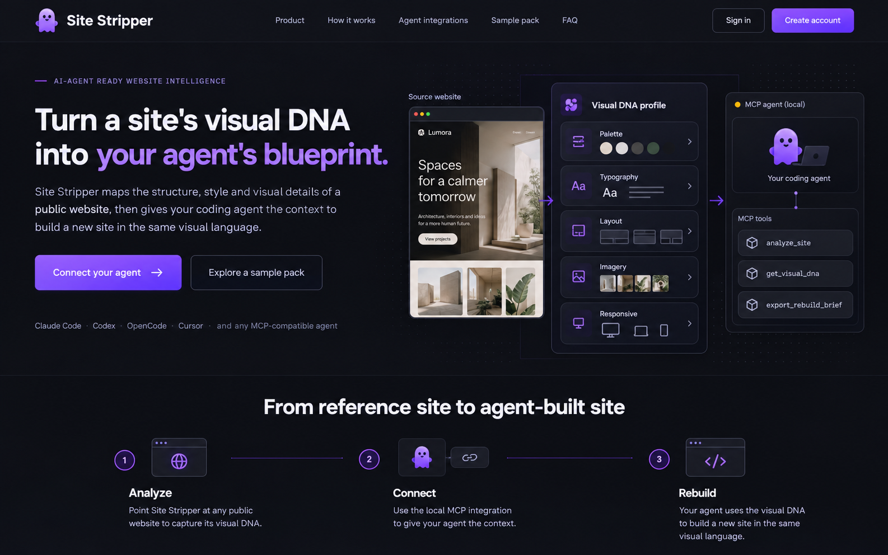
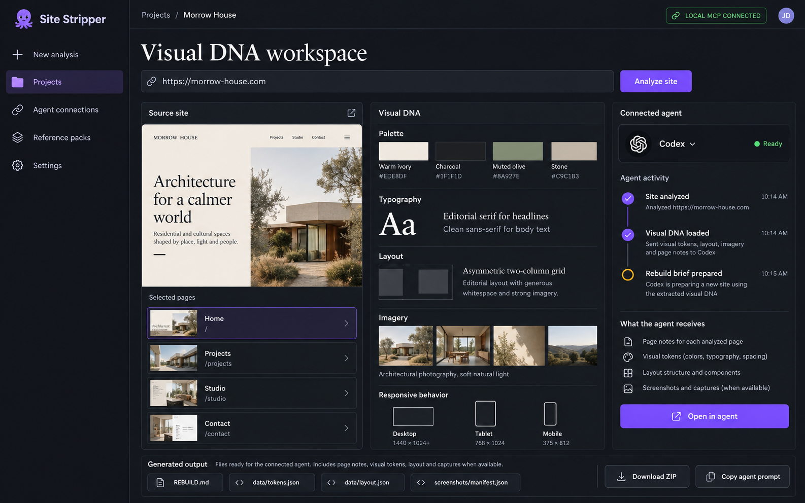

# Site Stripper Agent-Native SaaS Concept

## Status

The user approved the visual direction shown in the two concept images and asked for a more direct connection to coding agents. This design is ready for review before implementation planning. The accepted baseline remains tag [`v1.00`](../../../README.md#stable-baseline) and must not be altered by concept work.

## Goal

Present Site Stripper as an agent-native visual research workspace. It extracts the observable visual DNA of a public website, exposes that evidence directly to a coding agent, and helps the agent create a new site in the same visual language.

The product's AI story comes from a user's chosen coding agent. Site Stripper does not make a model call. A local MCP connection lets an agent request Site Stripper analysis and receive structured evidence for the agent's own reasoning and implementation. A ZIP and copyable build prompt remain available when a user prefers a manual handoff.

## Approved visual references

These images define the approved direction for the marketing site and local app UI:

The images are design references. Recreate their layouts and behaviors with project code rather than embedding the screenshots in the public site.

## Product and technical context

- The current analyzer gathers public page structure, visible content, design tokens, responsive observations, screenshots when captured, and rebuild documentation.
- The hosted Worker exposes the existing analysis endpoint. The ZIP is assembled in the browser today.
- The public Cloudflare Pages bundle contains marketing and account pages only. The analyzer interface remains local at `/app/`.
- Sign-up and sign-in forms remain browser-only. They do not create accounts, transmit submitted values, or save account records.
- The product has no database, authentication provider, payment provider, or AI API integration. Keep those boundaries.
- Hosted analysis remains limited to public sites, up to 10 pages and 150 seconds. Captures may be partial or unavailable.

## Experience concept

### Marketing site

The homepage explains the complete agent workflow immediately: analyze a public reference, extract its visual DNA, connect a coding agent, and build a new site from the evidence. Its hero pairs the product promise with a visual sequence showing a source page, a structured Visual DNA profile, and a local MCP agent.

The marketing content should explicitly present Site Stripper as an **AI-powered website understanding and rebuild workflow**, powered by the coding agent the user connects. Explain that the agent can read page notes, palette and typography observations, layout and responsive records, and captures when available. Name Claude Code, Codex, OpenCode, Cursor, and any other MCP-compatible agent. Keep the existing sample pack and explain ZIP export as a fallback handoff. Do not imply that Site Stripper itself runs or owns a language model.

### App workspace

The local app becomes a focused Visual DNA workspace with three complementary areas:

1. **Source site:** analyzed URL, selected pages, page list, and available captures.
2. **Visual DNA:** observed palette, typography, layout, imagery, and responsive patterns with links back to source evidence.
3. **Connected agent:** configured client, connection state, run activity, and the evidence the agent can use.

The bottom output strip exposes the rebuild guide and key structured files, plus Download ZIP and Copy agent prompt actions. Agent status must reflect an actual connection when that capability is implemented. Do not show a live connected state when only static presentation data exists.

### Agent connection flow

1. The user opens Agent connections and chooses a supported MCP client.
2. Site Stripper provides client-specific setup instructions and the local MCP configuration.
3. The coding agent requests an analysis for a public URL through Site Stripper's MCP tools.
4. Site Stripper returns a compact summary and source-linked evidence. The agent can request additional page or token details as needed.
5. The agent creates the new site in its own project workspace. Site Stripper provides the ZIP and copyable prompt as a manual alternative.

An example agent request is: “Analyze this public site and build a new project that follows its visual DNA. Use the captured evidence, then compare the result against the included screenshots.”

## MCP integration boundary

Use MCP as the provider-neutral connection between Site Stripper and local coding agents. The initial tool surface should be small and read-only:

- `analyze_public_site(url, maxPages, includeMobile)` starts one bounded analysis and returns a run identifier and concise summary.
- `get_visual_dna(runId)` returns a compact overview of observed style, coverage, and source confidence.
- `get_page_evidence(runId, pagePath)` returns page-specific content, design, layout, and capture references.
- `get_rebuild_brief(runId)` returns the build guidance already supported by the package generator.

Large screenshots and complete ZIP contents should not be dumped into one model response. The agent requests focused evidence; the app retains ZIP download for full binary output. Reuse the existing analysis API and package-generation logic where practical. Keep temporary run state in memory only and avoid adding a database or permanent history.

The local MCP server does not call an LLM. The connected coding agent uses its own model and account. If users pass Site Stripper output to an agent, that agent's provider may process the content under its own settings and policies. State this in the connection setup UI.

Official client setup references:

- [Claude Code MCP](https://code.claude.com/docs/en/mcp)
- [Codex MCP](https://developers.openai.com/codex/mcp/)
- [Cursor MCP](https://docs.cursor.com/context/model-context-protocol)
- [OpenCode MCP](https://docs.opencode.ai/docs/mcp-servers/)

## Visual system

- Retain the Site Stripper mascot and recognizable violet brand.
- Use an ultra-modern charcoal workspace with purple and lavender as the main accents, crisp white text, and restrained warm-yellow status details.
- Favor dense but readable evidence panels, clear dividers, editorial headings, and meaningful source imagery over generic card grids or decorative gradients.
- Make connection status, analysis progress, coverage limits, and available output easy to scan.
- Preserve the required footer line: `© 2026 Site Stripper. Made with ❤️ by CHEEE.WORK`.
- Keep the public site free of fake customers, testimonials, adoption statistics, guaranteed fidelity claims, and any statement that a provider model runs inside Site Stripper.

## Scope and boundaries

In scope:

- A refreshed marketing site and local app workspace following the approved images.
- A direct MCP-based coding-agent workflow with client setup guidance.
- Agent-readable analysis summaries and focused evidence requests.
- Existing ZIP and prompt export as fallback handoff.

Out of scope:

- Clerk, Stripe, D1, Pages Functions, account persistence, billing, or a new hosted service.
- A Site Stripper-owned model call or API key.
- Public hosting of the analyzer interface.
- Writes to the source website, form submission, CAPTCHA bypass, or arbitrary interaction replay.

## Design acceptance criteria

1. The marketing site clearly presents Site Stripper as the visual-DNA source that coding agents can call directly.
2. The local app matches the approved dark workspace concept and gives source evidence, Visual DNA, and agent activity distinct, useful areas.
3. Claude Code, Codex, OpenCode, Cursor, and other compatible agents have clear connection guidance without a new hosted AI provider.
4. MCP tools reuse bounded analysis behavior, return focused evidence, and avoid persistent result storage.
5. The interface can distinguish “not configured,” “connected,” “analyzing,” “ready,” and failure states truthfully.
6. Users can still inspect and download the full ZIP or copy a rebuild prompt.
7. The `v1.00` tag remains unchanged; implementation work starts from it on a separate branch.
